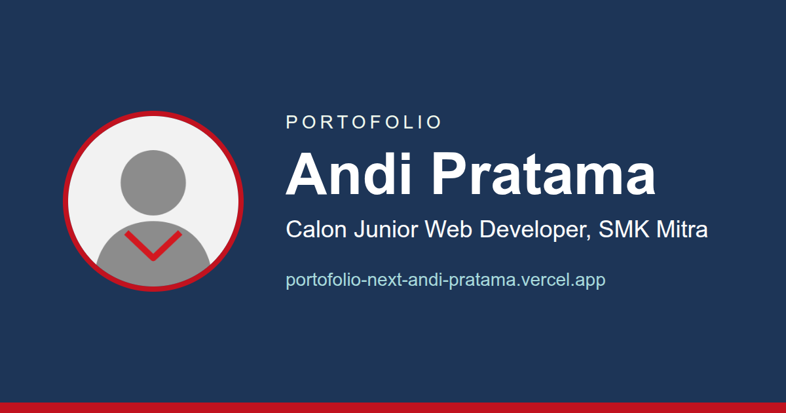

# Portofolio Andi Pratama

Website portofolio pribadi Andi Pratama, siswa kelas X SMK Mitra, peserta Kelas Industri UBIG
Paket 1 (Full Stack Basic). Datanya tersimpan di Supabase dan website-nya di-deploy di Vercel.



**Website:** https://portofolio-next-andi-pratama.vercel.app

## Fitur

- Beranda berisi profil, keahlian dari database, tiga proyek terbaru, dan testimoni.
- Halaman Proyek dengan pencarian, filter kategori, dan halaman detail setiap proyek.
- Halaman Tentang dan halaman Kontak dengan validasi form.
- Buku Tamu yang menyimpan pesan pengunjung ke database.
- Halaman Kelola ber-PIN untuk menyematkan dan menghapus pesan serta mengelola data proyek.
- Mode gelap dan tampilan responsif di ponsel maupun laptop.
- Pratinjau tautan (Open Graph) saat dibagikan ke Telegram atau WhatsApp.

## Teknologi

- Next.js 16 (App Router) dan React 19
- Tailwind CSS dan shadcn/ui
- Supabase (database PostgreSQL)
- Vercel (hosting dan deploy otomatis)

## Menjalankan di Komputer Sendiri

1. Clone repositori ini, lalu buka foldernya di VS Code.
2. Jalankan `npm install` di terminal.
3. Buat berkas `.env.local` berisi empat variabel berikut. Nilainya diambil dari dasbor Supabase
   dan PIN buatan sendiri. Berkas ini tidak boleh di-commit.

   ```
   NEXT_PUBLIC_SUPABASE_URL=
   NEXT_PUBLIC_SUPABASE_PUBLISHABLE_KEY=
   SUPABASE_SECRET_KEY=
   ADMIN_PIN=
   ```

4. Jalankan `npm run dev`, lalu buka http://localhost:3000.

## Struktur Folder

| Folder | Isi |
| --- | --- |
| `src/app` | Halaman, layout, Server Actions, dan gambar Open Graph |
| `src/components` | Komponen buatan sendiri; folder `ui` berisi komponen shadcn/ui |
| `src/lib` | Koneksi Supabase, pemeriksaan PIN, dan fungsi `cn` |
| `public` | Foto profil dan gambar proyek |
| `docs` | Dokumentasi tabel database |
| `desain` | Kartu HTML sumber gambar Open Graph |

## Database

Tabel `projects`, `messages`, `skills`, `buku_tamu`, dan `testimonials` beserta policy-nya
dijelaskan di [docs/database.md](docs/database.md).

## Perjalanan Belajar

| Minggu | Hasil |
| --- | --- |
| 10 | Project Next.js pertama |
| 11 | Portofolio v3 multi-halaman |
| 12 | Filter dan pencarian proyek |
| 13 | Database portofolio di Supabase |
| 14 | Data proyek tampil dari database dalam komponen shadcn/ui |
| 15 | Buku tamu dan halaman kelola data |
| 16 | Portofolio v4 full stack |

## Penulis

Andi Pratama, SMK Mitra, Kelas Industri UBIG 2026/2027.
